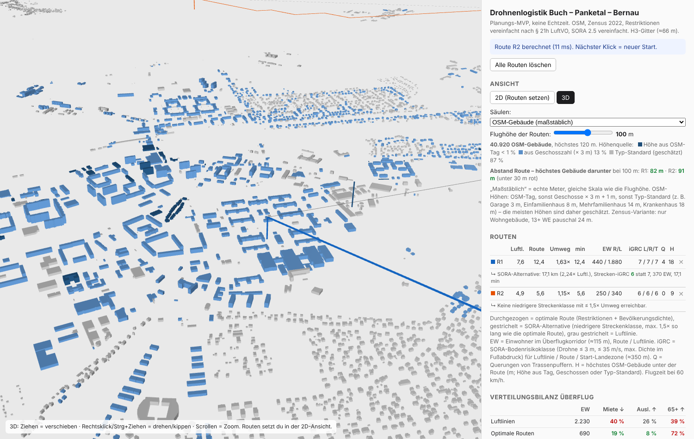

# Drone Logistics Planning MVP – Berlin-Buch / Panketal / Bernau

A small, browser-based **planning prototype** for drone logistics at the urban fringe of Berlin and Brandenburg.
It combines open data (OpenStreetMap, Census 2022) into a lightweight "planning twin" that shows where drones
could fly, which areas are restricted, how many people would be overflown, what a simplified SORA ground-risk
assessment looks like, and who would bear the burden of overflights.

**Not a real-time simulation and not an approval tool.** This is a demonstrator built in a single evening to test
how quickly a meaningful planning tool can be assembled from open data.



---

## Why this exists

Drone logistics (e.g. lab samples, medicines, groceries) is usually discussed either from a technology or an
aviation-safety perspective. Spatial planning is mostly missing, especially at the **edge of cities**, where
administrative borders meet (here: the city-state of Berlin and the federal state of Brandenburg) and where
access to basic services (*Daseinsvorsorge*) is often weakest.

The idea behind this MVP:

- **Planning instead of operations:** support early-stage questions such as *Which corridors are plausible? Where
  should hubs go? Who is affected?*, not flight control.
- **Open data first:** test what is possible with freely available data only, and make the **data gaps** visible
  (demand, mobile network coverage at flight altitude, rooftop suitability, daytime population, …).
- **Cross-border by design:** the study area deliberately spans Berlin (Buch) and Brandenburg (Panketal, Bernau).
- **A step towards a mobility data space:** the gaps show which actors would need to share which data, and under
  which conditions, for a real regional planning tool.

---

## What the map does (`docs/index.html`)

| Feature | Description |
|---|---|
| **Interactive routing** | Click a start and a destination (up to 3 routes). The optimal route is computed instantly in the browser. |
| **Restriction grid** | H3 hexagon grid (~66 m edge) with simplified restriction zones based on § 21h German Air Traffic Order (LuftVO): residential areas, nature reserves, 100 m buffers around motorways, main roads, railways, power lines and hospitals, industrial areas. |
| **Population density** | Census 2022, 100 m grid, used as ground risk. |
| **Simplified SORA 2.5** | Intrinsic ground risk class (iGRC) per cell for a drone ≤ 3 m / ≤ 35 m/s, using the **maximum** density within the footprint (cell + ~115 m buffer). For each route: iGRC of the straight line, the route and the take-off/landing zones, plus a "SORA alternative" route with a lower iGRC (if reachable with ≤ 1.5× the length of the optimal route). |
| **KPIs per route** | Length, detour factor, flight time (60 km/h), residents in the overflight corridor (route vs. straight line), crossings of infrastructure buffers, tallest building below the route. |
| **Distribution balance** | Share of overflown residents living in the third of the area with the lowest rents / highest share of foreign nationals / highest share of people aged 65+, compared with the whole area. |
| **Socio-spatial layers** | Share 65+, need indicator (65+ living > 1 km from the nearest pharmacy), average net rent, share of foreign nationals, estimated building heights (Census building types). |
| **3D view** (deck.gl) | ~41,000 OSM buildings to scale, routes at adjustable flight altitude (30–150 m), alternative columns for iGRC, residents and restrictions. Shows clearance between flight altitude and the tallest building below each route. |
| **dipul overlay** | Live WMS overlay of the official German drone geo-zones (DFS) for visual comparison. |

### Key observations from this study area

- Building heights are **not** the limiting factor at ~100 m flight altitude (typically 9–35 m); conflicts are on
  the ground (population, restrictions). Exceptions are single tall structures near take-off/landing sites.
- Under SORA, the **take-off and landing zones dominate the risk class**: a hub in dense housing (Buch) keeps the
  whole operation at iGRC 7, no matter how well the route avoids people. **Hub siting** is the main planning lever.
- Restriction- and density-aware routes overfly far fewer people than straight lines (~65–75 % fewer for longer
  routes), but they shift overflights towards low-density single-family areas with **older residents**, which is
  also the main target group for drone-delivered basic services. A distributional trade-off worth discussing.

---

## Study area & data

Study area: WGS84 bounding box **52.60–52.71 N, 13.44–13.63 E** (Berlin-Buch, Karow, Panketal, Bernau, ~150 km²).

| Data | Source | Licence |
|---|---|---|
| Restriction-relevant OSM features (land use, roads, railways, power lines, protected areas, health facilities) | OpenStreetMap via Overpass API | © OpenStreetMap contributors, ODbL |
| Buildings (~41,000 footprints, heights from tags/levels/type defaults) | OpenStreetMap via Overpass API | © OpenStreetMap contributors, ODbL |
| Population, share 65+, share of foreign nationals, average net rent, residential buildings by type (100 m grid) | Census 2022, Statistisches Bundesamt (Destatis), [zensus2022.de](https://www.zensus2022.de) | Datenlizenz Deutschland – Namensnennung 2.0 |
| Drone geo-zones (live overlay only, not stored) | dipul / DFS WMS | see [dipul.de](https://www.dipul.de) |

Raw data in `data/raw/` is already cut to the study area.

---

## Repository structure

```
├── docs/
│   ├── index.html          # the finished map (self-contained, ~7 MB) – also works with GitHub Pages
│   └── screenshot_3d.png
├── data/raw/
│   ├── osm_restrictions.geojson         # OSM features for the restriction grid
│   ├── osm_buildings.geojson.zip        # OSM buildings (zipped)
│   ├── zensus2022_population_100m.zip   # Census population, 100 m grid, cut to study area
│   └── zensus2022_social_100m.zip       # Census 65+, foreign nationals, rent, building types
├── src/
│   ├── analyse.py        # step 1: grid, restrictions, density, SORA, social indicators, routing export
│   ├── buildings.py      # step 2: OSM building heights, per-cell max height, compact footprints
│   ├── build_html.py     # step 3: inline everything into one HTML file
│   ├── engine.js         # in-browser routing (Dijkstra on the H3 grid) and KPIs
│   ├── template.html     # map UI (Leaflet + deck.gl)
│   └── vendor/h3-js.umd.js
├── scripts/
│   ├── run_pipeline.sh   # rebuilds docs/index.html from data/raw
│   └── extract_zensus.sh # cuts nationwide Census grid CSVs to the study area
└── requirements.txt
```

---

## How to use

**Just look at it:** enable GitHub Pages (*Settings → Pages → Branch: main, folder: /docs*) and open
`https://<user>.github.io/drone-logistics-planning-mvp/`. Internet connection needed (Leaflet, deck.gl, map tiles).

Note: if `docs/index.html` is opened as a local file, the OpenStreetMap tile servers block the basemap
("Access blocked", tile usage policy requires a referring website). All analysis layers still work; only the
background map is missing. Use the GitHub Pages link to share the prototype.

**Rebuild:**

```bash
pip install -r requirements.txt
bash scripts/run_pipeline.sh      # writes build/ and docs/index.html
```

**Another study area (~15 × 15 km works well):**

1. Change `BBOX` (and the fixed demo targets) at the top of `src/analyse.py`.
2. Export OSM data with [overpass-turbo](https://overpass-turbo.eu) → *Export → GeoJSON*:

   ```
   [out:json][timeout:180][bbox:S,W,N,E];
   ( nwr["landuse"~"^(residential|industrial|commercial|retail)$"];
     way["highway"~"^(motorway|trunk|primary)$"]; way["railway"="rail"]; way["power"="line"];
     nwr["leisure"="nature_reserve"]; nwr["boundary"="protected_area"];
     nwr["amenity"~"^(hospital|pharmacy|doctors|clinic)$"]; nwr["healthcare"="laboratory"]; );
   out geom;
   ```
   and for buildings: `[out:json][timeout:300][bbox:S,W,N,E]; way["building"]; out geom;`
3. Download the Census 2022 grid data (*Gitterdaten*) and cut it with `scripts/extract_zensus.sh`
   (update the EPSG:3035 bounds for the new area).
4. Run the pipeline.

---

## Limitations (please read)

- Restriction zones are **rebuilt from OSM** and simplified; they are **not** the official geo-zones.
- Population = residents on census day 2022; **no daytime population** (SORA 2.5 expects time-varying density).
- SORA covers **step 2 (iGRC) only**: no mitigations (M1/M2), no air risk (ARC), no SAIL, no OSOs. The footprint
  buffer is a fixed approximation.
- Cost weights in the routing are **set, not calibrated**. Results depend directly on them.
- ~87 % of OSM building heights are **type-based estimates**; OSM data contains errors (e.g. a 120 m object in Buch,
  unverified).
- Socio-spatial indicators are area-level data with census secrecy perturbation and gaps (e.g. rent only for rented
  dwellings). They are used **only for evaluation, never as routing costs**, to avoid automatically pushing
  overflights into disadvantaged areas. No conclusions about individuals.
- No demand data, no mobile network coverage at altitude, no landing-site/rooftop assessment, no noise model.

---

## How this could scale

1. **Window generator (quick):** parameterise the pipeline so any ~15 × 15 km window can be generated in minutes.
   Useful for comparing urban-fringe corridors (e.g. Spandau–Falkensee, Marzahn–Hoppegarten).
2. **All of Berlin (2D, a few hours):** use the Geofabrik Berlin extract instead of Overpass, and **add the official
   airspace restrictions** (ED-R 146 around the Reichstag, ED-R 4, BER control zone, hospital helipads). Routing
   in the browser scales to ~100k cells; the restriction layers should be dissolved by class.
3. **All of Berlin in 3D (½–1 day):** >500k buildings need a tiled approach (vector tiles or 3D Tiles served from a
   web server) instead of one HTML file; official **LoD2** building models (Berlin, Brandenburg) would replace the
   OSM height estimates.
4. **Towards a planning-grade tool:** full SORA (mitigations, air risk, SAIL), daytime population (e.g. mobile
   network data), noise modelling, demand data from health-care actors, U-space scenarios.
5. **Towards a mobility data space:** add a data catalogue (provider, licence, update status, access) and a gap
   catalogue (who holds the missing data, under which usage policy). Non-open data such as hospital shipment
   volumes or mobile coverage could later be connected via the Mobility Data Space (e.g. Eclipse Dataspace
   Components) instead of being copied.
6. **Participation:** use the map in workshops with municipalities, regional planning and residents to discuss
   corridors and hub locations across administrative borders.

---

## Credits & licence

Prototype by Paul Sauter (2026). Built with Python (geopandas, h3, pyproj), [Leaflet](https://leafletjs.com),
[deck.gl](https://deck.gl) and [h3-js](https://github.com/uber/h3-js) (Apache-2.0, see `src/vendor/LICENSE-h3-js`).

Basemap: © OpenStreetMap contributors. Data: © OpenStreetMap contributors (ODbL); Census 2022 © Statistisches Bundesamt (Destatis), dl-de/by-2-0.

Code licence: *not yet chosen* (add a `LICENSE` file, e.g. MIT, before publishing).
